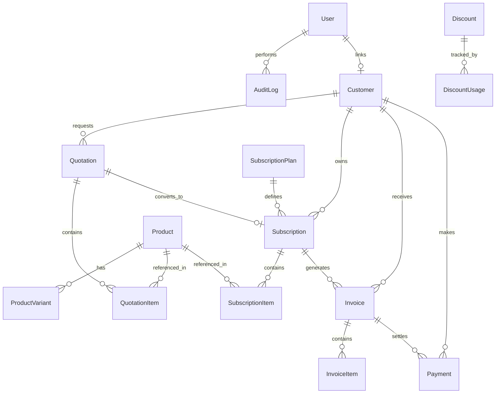

# Brightloop Subscription Management System — Database Schema

## 1. Entity-Relationship Overview
The schema is normalized to 3NF and implemented via Prisma ORM for PostgreSQL. All monetary columns use `Decimal(12, 2)` to avoid floating-point inaccuracy.

---

## 2. Table Definitions

### 2.1. `User`
- `id` (UUID, Primary Key)
- `email` (VarChar 255, Unique, Indexed)
- `passwordHash` (VarChar 255)
- `firstName` (VarChar 100)
- `lastName` (VarChar 100)
- `role` (Enum: `ADMIN`, `STAFF`, `CUSTOMER`)
- `phone` (VarChar 50, Nullable)
- `isActive` (Boolean, Default: true)
- `createdAt` (Timestamp), `updatedAt` (Timestamp)

### 2.2. `Customer`
- `id` (UUID, Primary Key)
- `userId` (UUID, Unique, Nullable, FK -> User.id)
- `companyName` (VarChar 255)
- `contactName` (VarChar 255)
- `email` (VarChar 255, Unique, Indexed)
- `phone` (VarChar 50)
- `billingAddress` (Text)
- `city` (VarChar 100), `state` (VarChar 100), `country` (VarChar 100), `postalCode` (VarChar 20)
- `taxNumber` (VarChar 100, Nullable)
- `currency` (VarChar 10, Default: 'USD')
- `notes` (Text, Nullable)
- `createdAt` (Timestamp), `updatedAt` (Timestamp)

### 2.3. `Product`
- `id` (UUID, Primary Key)
- `name` (VarChar 255)
- `code` (VarChar 50, Unique, Indexed)
- `type` (Enum: `SOFTWARE`, `SERVICE`, `HARDWARE`, `ADDON`)
- `salesPrice` (Decimal 12, 2)
- `costPrice` (Decimal 12, 2)
- `notes` (Text, Nullable)
- `isArchived` (Boolean, Default: false)
- `createdAt` (Timestamp), `updatedAt` (Timestamp)

### 2.4. `ProductVariant`
- `id` (UUID, Primary Key)
- `productId` (UUID, FK -> Product.id)
- `name` (VarChar 100)
- `description` (Text, Nullable)
- `additionalPrice` (Decimal 12, 2, Default: 0.00)
- `isActive` (Boolean, Default: true)

### 2.5. `SubscriptionPlan`
- `id` (UUID, Primary Key)
- `name` (VarChar 255)
- `description` (Text, Nullable)
- `basePrice` (Decimal 12, 2)
- `billingFrequency` (Enum: `DAILY`, `WEEKLY`, `MONTHLY`, `YEARLY`)
- `minQuantity` (Int, Default: 1)
- `startDate` (Timestamp)
- `endDate` (Timestamp, Nullable)
- `autoClose` (Boolean, Default: false)
- `allowEarlyClosure` (Boolean, Default: true)
- `allowPause` (Boolean, Default: true)
- `allowRenewal` (Boolean, Default: true)
- `isActive` (Boolean, Default: true)

### 2.6. `Quotation` & `QuotationItem`
- Quotation fields: `id`, `quotationNumber` (Unique), `customerId`, `templateId`, `status` (`DRAFT`, `SENT`, `ACCEPTED`, `REJECTED`, `EXPIRED`, `CONVERTED`), `validUntil`, `subtotal`, `taxAmount`, `discountAmount`, `totalAmount`, `notes`.
- QuotationItem fields: `id`, `quotationId`, `productId`, `variantId`, `quantity`, `unitPrice`, `taxRate`, `discountRate`, `amount`.

### 2.7. `Subscription` & `SubscriptionItem`
- Subscription fields: `id`, `subscriptionNumber` (Unique, Indexed), `customerId` (FK, Indexed), `quotationId` (Nullable), `planId` (FK), `status` (`DRAFT`, `QUOTATION`, `CONFIRMED`, `ACTIVE`, `PAUSED`, `CLOSED`), `startDate`, `expiryDate`, `nextBillingDate` (Indexed), `paymentTerms`, `autoClose`, `subtotal`, `taxAmount`, `discountAmount`, `totalAmount`.
- SubscriptionItem fields: `id`, `subscriptionId`, `productId`, `variantId`, `quantity`, `unitPrice`, `taxRate`, `amount`.

### 2.8. `TaxRule`
- `id`, `name`, `rate` (Decimal 5, 2, e.g. 18.00%), `description`, `isDefault`, `isActive`.

### 2.9. `Discount` & `DiscountUsage`
- Discount fields: `id`, `code` (Unique), `name`, `type` (`FIXED`, `PERCENTAGE`), `value` (Decimal 12, 2), `minPurchaseAmount`, `minQuantity`, `startDate`, `endDate`, `usageLimit`, `timesUsed`, `productId` (Nullable), `applyToWholeSub` (Boolean), `isActive`.
- DiscountUsage fields: `id`, `discountId`, `invoiceId`, `subscriptionId`, `customerId`, `amountApplied`, `usedAt`.

### 2.10. `Invoice` & `InvoiceItem`
- Invoice fields: `id`, `invoiceNumber` (Unique, Indexed), `subscriptionId` (Indexed), `customerId` (Indexed), `periodStart`, `periodEnd`, `invoiceDate`, `dueDate` (Indexed), `status` (`DRAFT`, `CONFIRMED`, `PAID`, `CANCELLED`), `subtotal`, `taxAmount`, `discountAmount`, `totalAmount`, `amountPaid`, `balanceDue`.
- Unique constraint: `@@unique([subscriptionId, periodStart])` to enforce idempotency.

### 2.11. `Payment`
- `id`, `paymentNumber` (Unique), `invoiceId` (FK), `customerId` (FK), `amount` (Decimal 12, 2), `paymentMethod` (`BANK_TRANSFER`, `CREDIT_CARD`, `CASH`, `CHECK`, `ONLINE`), `paymentDate`, `referenceNote`, `recordedById`.

### 2.12. `PasswordResetToken`
- `id`, `userId` (FK), `token` (Unique), `expiresAt`, `usedAt`.

### 2.13. `AuditLog`
- `id`, `userId` (Nullable), `action`, `entity`, `entityId`, `details` (JSON), `createdAt`.

### 2.14. `BusinessSettings`
- `id`, `companyName`, `currency`, `currencySymbol`, `taxNumber`, `contactEmail`, `contactPhone`, `address`, `invoicePrefix`, `quotationPrefix`, `subPrefix`.
